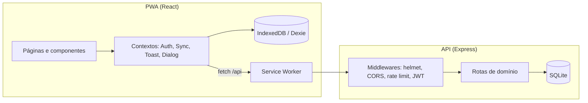
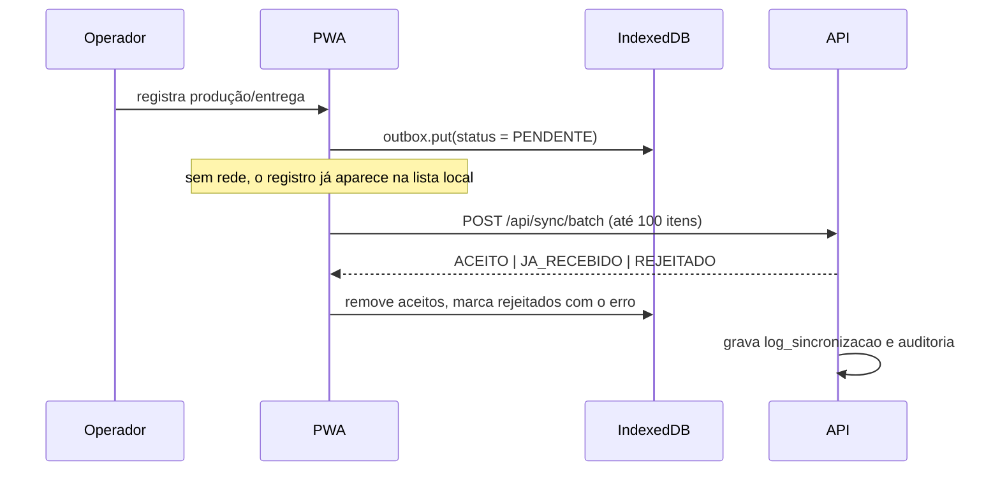

# Arquitetura

Este documento descreve como o Ceramix está organizado, quais garantias o sistema oferece e por que algumas decisões foram tomadas. Ele é o ponto de partida para quem vai manter ou evoluir o projeto.

## 1. Visão geral

O Ceramix é um monorepo npm com duas aplicações:

- **`apps/web`** — PWA offline-first em React. Funciona como app instalável no celular do operador e como painel no desktop da gestão.
- **`apps/api`** — API HTTP em Express com SQLite. É a autoridade sobre permissões, estado e histórico.

O contrato entre as duas partes é HTTP/JSON sob `/api`. Em desenvolvimento, o Vite faz proxy para a API; em produção, o Nginx do front repassa `/api` para o container da API. O front nunca conhece o endereço interno do servidor.

## 2. Princípios

1. **O servidor é a autoridade.** Estados, saldos e permissões só mudam na API. O cliente otimiza a experiência, não decide regra de negócio.
2. **Offline só cria.** Registros criados sem rede entram numa fila local. Validações, confirmações e cancelamentos exigem conexão.
3. **Nada é apagado.** Cancelamentos são lógicos, com motivo e auditoria. Estoques são revertidos quando a operação permite.
4. **Tudo é rastreável.** Toda escrita relevante registra usuário, dispositivo, horário e, quando aplicável, valor anterior e novo.
5. **Contratos explícitos.** Toda entrada HTTP é validada com Zod; erros têm formato consistente.
6. **Simplicidade operacional.** Um arquivo SQLite, uma API, um front estático. O modelo relacional é compatível com uma migração futura para MySQL/PostgreSQL.

## 3. Front-end

### Organização

| Diretório         | Responsabilidade                                                                      |
| ----------------- | ------------------------------------------------------------------------------------- |
| `src/pages/`      | Telas: login, home, produção, entregas, dashboard, auditoria, cadastros, fila offline |
| `src/components/` | Layout responsivo, ícones, componentes de UI e `ErrorBoundary`                        |
| `src/context/`    | Sessão, sincronização, toasts e diálogos de confirmação                               |
| `src/lib/`        | Cliente HTTP com refresh automático, Dexie, formatadores e permissões de UI           |
| `src/styles.css`  | Design system com tokens de cor, tipografia e breakpoints                             |

### Estado e sessão

- `AuthContext` restaura a sessão local (Dexie) e valida com `GET /api/auth/me`.
- Tokens ficam em `sessionStorage` e também em cookies `httpOnly` definidos pela API. O cliente HTTP usa `Authorization: Bearer` e renova a sessão automaticamente em um `401`, uma única vez por requisição, com fila compartilhada para evitar refresh duplicado.
- `SyncContext` controla catálogo local, fila de envio, contagem de pendências e sincronização periódica (a cada 60 s, ao voltar o foco e ao reconectar).
- `DialogContext` expõe `confirmar` e `pedirTexto` como promessas, evitando `window.confirm` e mantendo o fluxo visual.

### Offline-first

O banco local (`Dexie`, versão 1) tem quatro stores:

| Store        | Conteúdo                                                          |
| ------------ | ----------------------------------------------------------------- |
| `sessao`     | Usuário e dispositivo da última sessão                            |
| `referencia` | Catálogo completo (produtos, lotes, obras, veículos, metas…)      |
| `outbox`     | Registros pendentes ou rejeitados, com tipo, payload e tentativas |
| `meta`       | Identificador do dispositivo e data da última sincronização       |

Fluxo de envio:

- O `id` é gerado no cliente (UUID v4), o que torna o envio idempotente: repetir o mesmo lote não duplica registros.
- Registros rejeitados ficam visíveis na tela **Pendentes**, com o motivo e a opção de reenviar após correção.
- O catálogo é atualizado no início de cada sincronização e fica disponível para preencher formulários sem rede.

### PWA

- `vite-plugin-pwa` em modo `autoUpdate`, com manifest completo (ícones `any` e `maskable`, atalhos, orientação retrato).
- Estratégia `NetworkFirst` para `GET /api/*`, com timeout de 5 s e cache de 24 h — leituras degradam bem offline.
- Navegação usa `navigateFallback` para `/index.html`, permitindo deep links no app instalado.
- Breakpoints principais: 1100 px (sidebar compacta), 1023 px (sidebar vira topbar + navegação inferior), 640 px e 380 px (formulários e filtros em coluna).

## 4. Back-end

### Pipeline de requisição

1. `pino-http` gera/propaga `x-request-id` e registra método, rota, status e duração.
2. `helmet` aplica cabeçalhos de segurança.
3. CORS restringe origens configuradas; sem `Origin` (curl, health check) a requisição passa.
4. `express.json` limita o corpo a 1 MB.
5. Rate limit global por IP (`RATE_LIMIT_MAX` por minuto), desativado em testes.
6. Rotas de domínio aplicam `authenticate` e `requirePerm`.
7. `notFound` e o tratador central devolvem erros padronizados.

### Módulos

| Arquivo                    | Papel                                                                       |
| -------------------------- | --------------------------------------------------------------------------- |
| `src/config.js`            | Leitura e validação do ambiente com Zod; recusa segredos fracos em produção |
| `src/app.js`               | Composição do Express, health check e tratamento de erros                   |
| `src/server.js`            | Listen, logs de inicialização e shutdown gracioso (SIGINT/SIGTERM)          |
| `src/db/schema.js`         | DDL idempotente e índices                                                   |
| `src/db/connection.js`     | Conexão SQLite com WAL, `foreign_keys` e `busy_timeout`                     |
| `src/middleware/auth.js`   | Validação do JWT, checagem de usuário ativo e dispositivo revogado          |
| `src/utils/permissions.js` | Matriz de permissões por perfil                                             |
| `src/utils/audit.js`       | Inserção padronizada na trilha de auditoria                                 |
| `src/routes/auth.js`       | Login, refresh rotativo, logout, sessão atual                               |
| `src/routes/catalog.js`    | Catálogo, cadastros, usuários e dispositivos                                |
| `src/routes/producao.js`   | Criação idempotente, listagem, validação e cancelamento                     |
| `src/routes/entrega.js`    | Criação idempotente, listagem, confirmação, cancelamento e timeline         |
| `src/routes/sync.js`       | Lote de sincronização com log por item                                      |
| `src/routes/relatorios.js` | Dashboard, auditoria e exportação CSV                                       |

### Autenticação

- **Access token** JWT de 15 min (configurável), com `sub`, `perfil`, `empresa_id` e `dispositivo_id`.
- **Refresh token** de 7 dias, com `jti`; o hash SHA-256 é persistido em `refresh_tokens`.
- No refresh, o token usado é revogado e um novo par é emitido (rotação). Reutilização de token revogado falha.
- Login bloqueia a conta por 15 min após 5 falhas consecutivas e tem rate limit próprio de 20 tentativas por 15 min.
- Revogar um dispositivo invalida todos os refresh tokens dele; o access token em uso expira naturalmente em minutos.
- Senhas usam bcrypt (custo 10). O login inexistente executa uma comparação falsa para reduzir diferença de tempo.

## 5. Modelo de dados

O schema é relacional e multiempresa: praticamente todas as tabelas carregam `empresa_id`, e as consultas sempre filtram por ele. IDs são UUID em texto; datas são ISO 8601 em UTC.

| Grupo      | Tabelas                                                                                            |
| ---------- | -------------------------------------------------------------------------------------------------- |
| Identidade | `empresas`, `usuarios`, `dispositivos`, `refresh_tokens`                                           |
| Catálogo   | `produtos`, `turnos`, `motivos_refugo`, `metas_producao`, `lotes`, `clientes`, `obras`, `veiculos` |
| Produção   | `producoes`, `itens_producao`                                                                      |
| Expedição  | `entregas`, `itens_entrega`, `eventos_rastreio`                                                    |
| Controle   | `auditoria`, `log_sincronizacao`                                                                   |

Relações principais:

- `producoes` 1—N `itens_producao`; cada item aponta para produto e, opcionalmente, lote.
- `entregas` 1—N `itens_entrega`; cada item aponta para lote e produto.
- `eventos_rastreio` registra `qr_saida`, `gps_saida`, `qr_chegada`, `gps_chegada` e `confirmacao`.
- `lotes` mantém `quantidade_produzida` e `quantidade_expedida`; o saldo é sempre a diferença entre elas.
- Cancelamentos não removem linhas: atualizam status, motivo, autor e data.

Estados:

| Entidade      | Status                                         |
| ------------- | ---------------------------------------------- |
| Produção      | `pendente_validacao` → `validado`; `cancelado` |
| Entrega       | `saida_registrada` → `entregue`; `cancelada`   |
| Sincronização | `ACEITO`, `JA_RECEBIDO`, `REJEITADO`           |

`em_transito` existe no schema para evolução futura do rastreio, mas o fluxo atual trabalha com saída e chegada.

## 6. Regras de negócio implementadas

- Refugo não pode exceder a quantidade produzida (RN-07) e exige motivo quando maior que zero.
- A produção nasce como `pendente_validacao`; somente admin, gestor ou supervisor validam.
- Produção e entrega são idempotentes por `id` de cliente — reenvios devolvem `JA_RECEBIDO`.
- A baixa de lote na produção soma apenas peças boas (`produzida − refugo`).
- A entrega só é aceita se o lote estiver ativo, o produto conferir e houver saldo suficiente.
- Cancelar produção devolve peças boas ao lote; se parte do lote já foi expedida, o cancelamento é bloqueado com `409`.
- Cancelar entrega devolve a quantidade expedida ao saldo do lote.
- Relógio do cliente fora de 12 h da janela do servidor marca a observação com `[RELOGIO_SUSPEITO]`, sem rejeitar o registro.
- Entregas de conferente e motorista são filtradas para as que criaram ou que dirigem.
- O dashboard considera apenas produção `validado`; pendências aparecem em campo próprio.
- A meta do período é `soma(meta_diaria) × dias`; percentual de perda é refugo ÷ produzido; argila por peça é argila ÷ peças boas.

## 7. Matriz de permissões

| Ação                   | Admin | Gestor | Supervisor | Operador | Conferente | Motorista |
| ---------------------- | :---: | :----: | :--------: | :------: | :--------: | :-------: |
| `producao.criar`       |   ✓   |   ✓    |     ✓      |    ✓     |            |           |
| `producao.validar`     |   ✓   |   ✓    |     ✓      |          |            |           |
| `producao.cancelar`    |   ✓   |   ✓    |     ✓      |          |            |           |
| `producao.listar`      |   ✓   |   ✓    |     ✓      |    ✓     |            |           |
| `entrega.criar`        |   ✓   |   ✓    |     ✓      |          |     ✓      |     ✓     |
| `entrega.confirmar`    |   ✓   |   ✓    |     ✓      |          |     ✓      |     ✓     |
| `entrega.cancelar`     |   ✓   |   ✓    |     ✓      |          |            |           |
| `entrega.listar`       |   ✓   |   ✓    |     ✓      |          |     ✓      |     ✓     |
| `dashboard.ver`        |   ✓   |   ✓    |     ✓      |    ✓     |     ✓      |     ✓     |
| `cadastros.gerir`      |   ✓   |   ✓    |            |          |            |           |
| `usuarios.gerir`       |   ✓   |        |            |          |            |           |
| `auditoria.ver`        |   ✓   |   ✓    |     ✓      |          |            |           |
| `dispositivos.revogar` |   ✓   |        |            |          |            |           |
| `sync.enviar`          |   ✓   |   ✓    |     ✓      |    ✓     |     ✓      |     ✓     |

A interface esconde rotas por perfil, mas a decisão final é sempre do `requirePerm` na API.

## 8. Segurança

- Validação de ambiente na inicialização; produção recusa segredos previsíveis ou repetidos.
- JWT com segredos separados para access e refresh; refresh rotativo e persistido apenas como hash.
- Cookies `httpOnly`, `SameSite=Lax` e `Secure` em produção.
- Helmet, CORS por lista explícita, limite de corpo e rate limits global e de login.
- Consultas sempre parametrizadas (`better-sqlite3`), sem interpolação de entrada do usuário.
- `pino` oculta `Authorization`, cookies, senhas e tokens nos logs.
- Erros 5xx devolvem mensagem genérica e `requisicao_id` para correlação.
- Auditoria imutável pela aplicação: não há rota de alteração ou remoção.

## 9. Decisões e trade-offs

| Decisão                              | Motivo                                                       | Custo                                            |
| ------------------------------------ | ------------------------------------------------------------ | ------------------------------------------------ |
| SQLite em vez de MySQL no MVP        | Zero infraestrutura, transações confiáveis e backup trivial  | Escrita serializada; não escala horizontalmente  |
| Express 4                            | Ecossistema estável e familiar                               | Sem recursos nativos de async/await do Express 5 |
| Idempotência por ID de cliente       | Reenvios offline são inevitáveis                             | Cliente precisa gerar e preservar UUIDs          |
| Catálogo completo em vez de delta    | Simplicidade e robustez no primeiro carregamento             | Payload maior; aceitável para o volume do MVP    |
| Rotas com SQL direto                 | Transparência e performance em consultas de relatório        | Mais código manual que um ORM                    |
| Tokens em memória + cookies          | PWA e integrações via Bearer usando o mesmo backend          | Duas formas de autenticação para manter          |
| Fila local sem resolução de conflito | O domínio é majoritariamente de criação; edição exige online | Edições offline ficam fora do escopo             |

## 10. Evolução sugerida

1. Migrar a persistência para PostgreSQL quando houver múltiplas instâncias da API, mantendo o schema e as consultas parametrizadas.
2. Extrair a lógica de criação/validação para serviços de domínio testáveis, hoje embutida nas rotas.
3. Adicionar testes de componente e E2E (Playwright) para fluxos críticos da PWA.
4. Implementar transição explícita para `em_transito` e rastreio periódico, caso o produto exija.
5. Adicionar observabilidade externa (OpenTelemetry) e alertas sobre o health check.
6. Introduzir gestão de segredos (Vault/Secrets Manager) e rotação de chaves.

## 11. Convenções

- Código, rotas e mensagens em português; nomes de tabelas e colunas no domínio (`producoes`, `quantidade_refugo`).
- IDs UUID v4; timestamps ISO 8601 UTC; dinheiro e quantidades como números.
- Sem ponto e vírgula, aspas simples, largura 100 (Prettier).
- Erros HTTP com corpo `{ "erro": "mensagem" }` e, quando útil, `detalhes`.
- Toda rota nova deve declarar `requirePerm` e gerar auditoria quando alterar estado.
